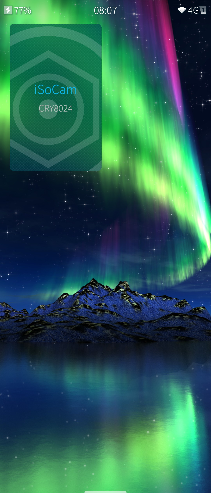
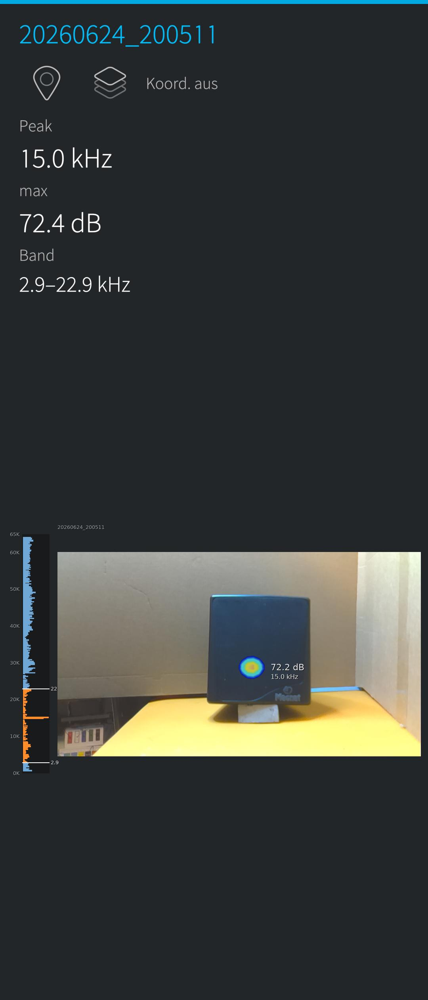
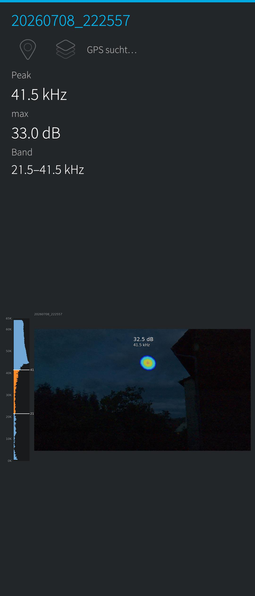
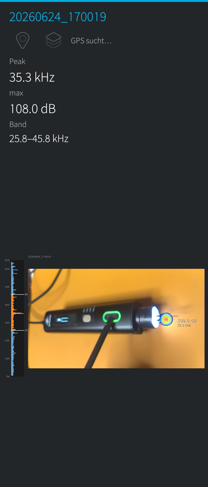

# iSoCam

A native, (inofficial) Sailfish OS app for the **Crysound SonoCam Pocket CRY8024**
acoustic camera. It downloads the stored measurements over WiFi and composes the
camera photo, the acoustic source overlay and the frequency data into one finished
image — ready for field documentation.

Silica/QML + PyOtherSide, built and used on an Xperia 10 III: measurements list, full
analysis view, phone-GPS geotagging with an OpenStreetMap silhouette background,
gallery-style swiping, a live WiFi view, and a WYSIWYG image export.

> **Not affiliated with, endorsed by, or connected to Crysound.** “Crysound”,
> “SonoCam” and any product names are trademarks of their respective owners. This
> project is called **iSoCam** and is named that way deliberately — the vendor's
> names appear here only descriptively, to identify the hardware it works with.

## See it working



Three measurements as the app exports them — camera photo, acoustic overlay, the
loudest spot with its dB and dominant frequency, and the dB-scale spectrum bars down
the left edge. The export is WYSIWYG: what the screen shows is what lands in
`~/Pictures/isocam`.

On the right, the app's own live cover on the home screen.

| A speaker playing a 15 kHz tone | A bat, picked out of the night sky | An ultrasonic cutter at work |
|---|---|---|
|  |  |  |
| 72.4 dB, band 2.9–22.9 kHz | 41.5 kHz at 33.0 dB — faint, far, and still placed against a dark sky | 108.0 dB at 35.3 kHz — the blade tip, not the handle |

## Why

I do not carry an Apple or an Android phone. My phone runs **Sailfish OS** — right
now an Xperia 10 III — and the vendor's official app is published only for iOS and
Android, so it is simply not available to me. There is no PC software for the Pocket
model either: the analysis happens on the camera itself, and the files it produces
are otherwise reachable only through that mobile app.

So the camera came with no usable client at all. That is what this project is: a
client written for the phone I actually use, which fetches a measurement's parts off
the camera and composes them back into **one finished JPEG** — the picture, the sound
on top of it, the numbers beside it. Something you can put in a report.

Neither the `.doa` layout nor the HTTP interface is documented anywhere, so both had
to be worked out from the files and the traffic first. What that produced is written
down below and in [`docs/API.md`](docs/API.md).

## How it works

### Where the data sits on the camera

The camera runs an HTTP server on TCP **9999** over its WiFi. Under `imager/Default/`
it keeps one directory per measurement, named after its timestamp
(`20260624_200511/`), and inside that directory the measurement is split across
several files:

| File | What it holds |
|------|---------------|
| `<ts>_1.jpg` | the optical camera photo, 1280 × 720 |
| `<ts>_0.jpg` | the acoustic overlay — 800 × 480, ~99 % transparent, only the sound blob is painted |
| `<ts>.doa` | a text header plus binary data: a 32 × 24 direction-of-arrival grid and a 3201-bin power spectrum |
| `info.json` | the metadata — the selected frequency band, the detected peaks as `{x, y, dB}`, max dB SPL, scenario, distance |
| `<ts>.wav` | the recording itself, mono 16-bit at roughly 130 kHz sample rate (ultrasound needs the headroom) |
| `.thumbnail.jpg`, `dateTime`, `scenarioMode` | small extras the on-device gallery uses |

Nothing on the camera ever draws these together into a single image — that view
exists only live on its own screen, and is gone once you walk away.

### How this client puts them back together

1. The photo `<ts>_1.jpg` becomes the base layer.
2. The overlay `<ts>_0.jpg` is scaled onto it and composited, so the sound blob lands
   where the sound actually was.
3. The peak list from `info.json` gives the loudest spot; its dB value is drawn next
   to it.
4. The power spectrum from the `.doa` file is turned into the dB-scale bar graph down
   the left edge, and the strongest bin *inside the selected band* becomes the
   dominant frequency printed beside the spot.
5. The result is flattened to one JPEG and saved to `~/Pictures/isocam`.

One catch worth knowing about: the `.doa` power spectrum is stored **backwards** —
bin 0 is the Nyquist end at 65 kHz, not 0 Hz. The frequency axis was calibrated
against an SDG6022X signal generator with known tones; the fit lives in
[`python/isocam_core/freq_calib.json`](python/isocam_core/freq_calib.json) and is
applied on read.

See [`docs/API.md`](docs/API.md) and the in-code comments for the HTTP endpoints and
the full `.doa` layout.

## Install on Sailfish OS

Grab the RPM from the [releases](../../releases) and install it, or build it yourself
with the Sailfish SDK:

```bash
mb2 -t SailfishOS-5.0.0.62-aarch64 build
```

It is a noarch package and needs only Pillow + PyOtherSide — no numpy, no matplotlib,
neither of which exists on a stock device.

**First run:** open the pulley menu and set **Kamera-Adresse** to the address your
camera has on your WiFi — the shipped default is only a placeholder. The camera shows
it in its own WLAN settings; the port (9999) is added automatically. The value is kept
in dconf under `/apps/harbour-isocam/cameraHost`. Enable Location in Settings if you
want the geotagging.

## Notes and limitations

- **No live spectrum.** The Pocket exposes a live camera frame, dB peaks and the
  current band — but no live FFT/spectrum over any interface. The spectrum bars come
  from saved `.doa` files only.
- All audio processing is on-device; the raw 64-channel microphone data is not
  exposed by the camera.

## License

[MIT](LICENSE). The SailfishOS map-fetch helper (`backend.osm_ways`) is adapted from
the author's own `harbour-iwifi`. Map data © OpenStreetMap contributors.
